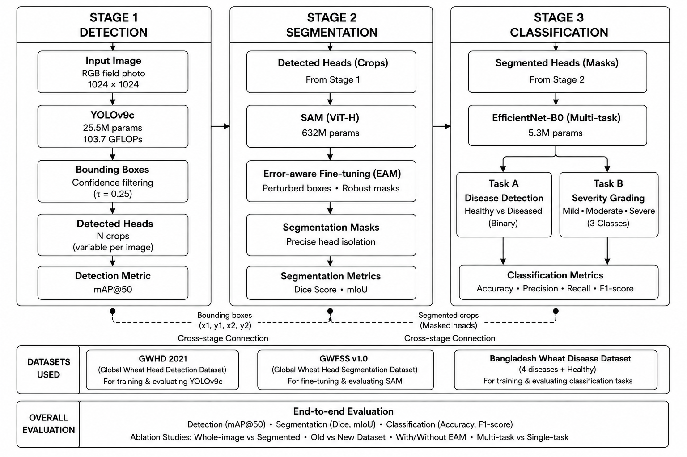

# SegWheat-DSG

**A Segmentation-Guided Framework for Wheat Head Disease Detection and Severity Grading**

SegWheat-DSG is a three-stage pipeline that goes from a raw field photograph to a per-head disease and severity map. It detects every wheat head, segments each one at pixel level, then classifies the disease type and severity of each isolated head.



---

## Table of Contents

- [Overview](#overview)
- [Pipeline](#pipeline)
- [Results](#results)
- [Datasets](#datasets)
- [Installation](#installation)
- [Usage](#usage)
- [Training Configuration](#training-configuration)
- [Limitations](#limitations)
- [Future Work](#future-work)
- [Citation](#citation)

---

## Overview

Wheat diseases such as Wheat Blast, Fusarium Foot Rot, Leaf Blight and Black Point threaten food security, particularly in regions like Bangladesh. Existing work tends to fall into two separate groups:

- **Segmentation frameworks** locate wheat heads but say nothing about their health.
- **Disease classifiers** work on whole-field images, so the model must learn through soil, stems and neighbouring plants.

SegWheat-DSG connects the two. Each wheat head is detected, segmented, and cropped with the background removed before being passed to a multi-task classifier that predicts disease class and severity grade together.

**Key features**

- End-to-end pipeline with no manual intervention
- YOLOv9c detection → SAM ViT-H segmentation (with error-aware fine-tuning) → multi-task EfficientNet-B0
- Joint five-class disease detection and three-level severity grading
- Per-head annotated output overlaid on the original image
- Runs on a single consumer GPU (RTX 3060 Ti, 8 GB)

---

## Pipeline

| Stage | Task | Model | Dataset |
|-------|------|-------|---------|
| 1 | Wheat head detection | YOLOv9c (25.5M params) | GWHD 2021 |
| 2 | Wheat head segmentation | SAM ViT-H + error-aware module | GWFSS v1.0 |
| 3 | Disease detection + severity grading | Multi-task EfficientNet-B0 (~5.3M params) | Bangladesh Wheat Disease Dataset |

**Stage 1: Detection.** YOLOv9c, initialised from COCO weights and fine-tuned for a single class, outputs bounding boxes (confidence threshold 0.25). Training uses mosaic, mixup, flips, HSV jitter, scale, shear and translation augmentation.

**Stage 2: Segmentation.** Bounding boxes prompt SAM ViT-H. The image encoder (632M parameters) is frozen; only the prompt encoder and mask decoder (~4.06M parameters) are trained. An error-aware module perturbs ground-truth boxes during training (probability 0.8, shift ±20 px, scale ±20%, minimum IoU 0.1) so the model copes with imperfect detector boxes at inference. The loss is `L_seg = L_Dice + L_Focal + L_IoU`.

**Stage 3: Classification.** A shared EfficientNet-B0 backbone feeds two heads:

- **Disease head:** Healthy, Black Point, Fusarium Foot Rot, Leaf Blight, Wheat Blast
- **Severity head:** Mild, Moderate, Severe

The combined loss is `L_total = L_disease + 0.5 · L_severity`. Severity loss is masked to diseased samples only, so healthy samples never contribute a severity penalty.

### Severity mapping

| Class | Label | Severity |
|-------|-------|----------|
| Healthy | 0 | None |
| Black Point | 1 | Mild |
| Fusarium Foot Rot | 2 | Moderate |
| Leaf Blight | 3 | Moderate |
| Wheat Blast | 4 | Severe |

---

## Results

### Stage 1: Detection (GWHD 2021 validation set)

| Metric | SegWheat-DSG | WheatSAM baseline |
|--------|:------------:|:-----------------:|
| mAP@50 | **93.9%** | 87.41% |
| mAP@50-95 | **53.9%** | 44.67% |
| Precision | 91.8% | n/a |
| Recall | 88.2% | n/a |
| Inference speed | 21.2 ms/image | n/a |

### Stage 2: Segmentation

| Model | Dice | mIoU |
|-------|:----:|:----:|
| WheatSAM zero-shot | 89.45% | 81.51% |
| WheatSAM error-aware | 89.74% | 81.96% |
| Najafian et al. | 89.00% | n/a |
| **SegWheat-DSG (GWFSS v1.0)** | 87.61% | 79.56% |

> The segmentation scores are not directly comparable with the baselines. They were evaluated on a geographically diverse, multi-institution split rather than a single-domain dataset.

### Stage 3: Classification (held-out test set)

| Task | Test images | Accuracy |
|------|:-----------:|:--------:|
| Five-class disease detection | 241 | **99.59%** |
| Three-class severity grading | 203 | **99.51%** |

Per-class results:

| Class | Precision | Recall | F1 | Support |
|-------|:---------:|:------:|:--:|:-------:|
| Healthy | 0.97 | 1.00 | 0.99 | 38 |
| Black Point | 1.00 | 0.98 | 0.99 | 45 |
| Fusarium Foot Rot | 1.00 | 1.00 | 1.00 | 38 |
| Leaf Blight | 1.00 | 1.00 | 1.00 | 60 |
| Wheat Blast | 1.00 | 1.00 | 1.00 | 60 |

| Severity | Precision | Recall | F1 | Support |
|----------|:---------:|:------:|:--:|:-------:|
| Mild | 1.00 | 0.98 | 0.99 | 45 |
| Moderate | 0.99 | 1.00 | 0.99 | 98 |
| Severe | 1.00 | 1.00 | 1.00 | 60 |

### Full pipeline

Inference takes under 30 seconds per image on an RTX 3060 Ti, covering detection, per-head segmentation and classification.

---

## Datasets

All datasets are publicly available under CC BY 4.0.

| Stage | Dataset | Images | Notes |
|-------|---------|-------:|-------|
| 1 | Global Wheat Head Detection (GWHD) 2021 | 6,514 | 1024×1024, 275,000+ labelled heads, 12 countries |
| 2 | GWFSS v1.0 (Global Wheat Full Semantic Segmentation) | 1,096 | Pixel-level masks; 80/20 split (876 train / 220 val) |
| 3 | Bangladesh Wheat Disease Dataset | 1,603 | 1920×1080, five classes; 70/15/15 split (1,122 / 240 / 241) |

**Preprocessing highlights**

- GWHD boxes converted to YOLO normalised format; duplicate labels removed
- GWFSS images resized to 1024×1024 and masks to 256×256 (nearest-neighbour); per-head boxes extracted by connected component analysis
- Bangladesh images resized to 224×224 and normalised with ImageNet statistics
- `WeightedRandomSampler` used to counter class imbalance in Stage 3

---

## Installation

**Requirements**

- Python 3.13
- PyTorch 2.11.0 with CUDA 12.8
- NVIDIA GPU with at least 8 GB VRAM (tested on RTX 3060 Ti)

```bash
git clone https://github.com/<your-username>/<your-repo>.git
cd <your-repo>

python -m venv venv
source venv/bin/activate        # Windows: venv\Scripts\activate

pip install -r requirements.txt
```

**Main dependencies:** Ultralytics 8.4.48 (YOLOv9), Segment Anything (SAM), timm 0.9 (EfficientNet-B0), scikit-learn, OpenCV.

**Model weights**

Download the pretrained checkpoints and place them in the expected folder:

| Model | Link |
|-------|------|
| YOLOv9c (wheat head detector) | _add link_ |
| SAM ViT-H (fine-tuned decoder) | _add link_ |
| EfficientNet-B0 (multi-task classifier) | _add link_ |

---

## Usage

> Replace the script names below with the actual entry points in this repository.

**Run the full pipeline on an image**

```bash
python run_pipeline.py --image path/to/field_image.jpg --output results/
```

**Train each stage**

```bash
python train_detection.py        # Stage 1: YOLOv9c
python train_segmentation.py     # Stage 2: SAM ViT-H (decoder only)
python train_classification.py   # Stage 3: multi-task EfficientNet-B0
```

**Output**

For each input image the pipeline produces the original image with coloured segmentation masks, plus a disease label and severity grade for every detected wheat head.

---

## Training Configuration

| Parameter | Stage 1 | Stage 2 | Stage 3 |
|-----------|---------|---------|---------|
| Model | YOLOv9c | SAM ViT-H | EfficientNet-B0 |
| Optimiser | AdamW | AdamW | AdamW |
| Learning rate | 5×10⁻⁴ | 1×10⁻⁷ | 1×10⁻⁴ |
| Weight decay | 5×10⁻⁴ | 1×10⁻⁵ | 1×10⁻⁴ |
| Batch size | 4 | 1 | 32 |
| Max epochs | 100 | 30 | 30 |
| Early stopping | patience 20 | none | patience 7 |
| LR schedule | Cosine anneal | Fixed | ReduceLROnPlateau |
| Mixed precision | Yes | AMP | Yes |

Hardware: NVIDIA GeForce RTX 3060 Ti (8 GB), Intel Core i7, 32 GB RAM.

---

## Limitations

- **Error propagation is not evaluated.** Stage 3 was trained on the Bangladesh dataset images, not on crops produced by the live Stage 1–2 pipeline. End-to-end accuracy under realistic detection and segmentation errors has not been measured.
- **Whole-image vs segmented comparison is indirect.** Comparisons with prior classifiers use published figures on different data and splits, so they are not controlled experiments.
- **Coarse severity.** Three discrete levels cannot separate, for example, 15% and 85% infection within the same level.
- **Limited geographic scope.** The disease classifier was trained only on Bangladeshi field imagery.
- **Small test set.** Stage 3 results come from 241 test images, so near-perfect scores should be interpreted cautiously.
- **Hardware.** An 8 GB GPU forced a batch size of 1 for SAM fine-tuning.

---

## Future Work

- Retrain and evaluate Stage 3 on live pipeline crops for true end-to-end results
- Use the 48,675 unannotated GWFSS v1.0 images for semi-supervised SAM fine-tuning
- Replace discrete severity levels with a continuous severity regression head
- Validate across regions, cultivars and pathogen strains
- Deploy as a desktop tool for field officers or integrate with UAV surveys to produce field-level disease heat maps

---

## Citation

If you use this work, please cite:

```bibtex
@misc{segwheatdsg2026,
  title  = {SegWheat-DSG: A Segmentation-Guided Framework for Wheat Head Disease Detection and Severity Grading},
  year   = {2026}
}
```

---

## License

This project is released under the [MIT License](LICENSE). The datasets used are released under CC BY 4.0; please follow their respective terms. Third-party models (YOLOv9, Segment Anything, EfficientNet) are subject to their own licenses.
