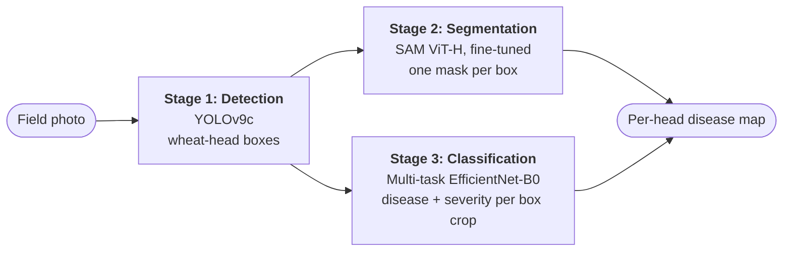

# SegWheat-DSG

**Wheat head detection, segmentation, and disease/severity classification with YOLOv9, SAM, and EfficientNet-B0**


A university project (Department of CSE, University of Asia Pacific). Three models are trained separately, one per stage, and chained into a single inference pipeline that takes a wheat field photograph and draws a per-head map of detected heads, masks, disease classes, and severity levels.

## Overview



1. **Stage 1** finds every wheat head with YOLOv9c and returns bounding boxes.
2. **Stage 2** prompts a fine-tuned SAM ViT-H with each box to get a mask.
3. **Stage 3** crops each box from the image and classifies it with a two-headed EfficientNet-B0: a 5-class disease head and a 3-class severity head.

In the current code the SAM masks are used for the overlay only. The classifier receives the rectangular box crop, not the masked region (see [Limitations](#limitations)).

## Results at a glance

| Stage | What was measured | Result |
|---|---|---|
| 1. Detection | GWHD 2021 validation set (1,476 images, 44,347 boxes) | Precision 0.918, recall 0.882, **mAP@50 0.939**, mAP@50-95 0.539 |
| 2. Segmentation | Box-prompted (boxes taken from the ground-truth masks), 220-image validation split | **Dice 0.8753**, mIoU 0.7924 |
| 3. Disease (5 classes) | Test split (241 images) | **99.59%** accuracy (240 of 241) |
| 3. Severity (3 levels) | Test split, diseased images only (203) | **99.51%** accuracy (202 of 203) |

Please read [Limitations](#limitations) before relying on these numbers. In particular, the severity labels are derived from the disease class, and Stage 3 was trained on whole photographs rather than on detected heads.

## How each model is used and trained

### Stage 1: Wheat head detection (YOLOv9c)

- **Data:** Global Wheat Head Detection (GWHD) 2021, using the competition CSVs: 3,657 training and 1,476 validation images. The 1,382-image test CSV is loaded but not used. Boxes are parsed from `BoxesString` and converted to YOLO format with a single class, `wheat_head`.
- **Model:** `yolov9c.pt` (COCO-pretrained), fine-tuned with Ultralytics at 1024×1024.
- **Training:** AdamW, learning rate 5e-4 with cosine decay, batch size 4, up to 100 epochs with early stopping (patience 20). Training stopped at epoch 45 and the best checkpoint is from epoch 25 (about 7.8 hours in total).
- **Augmentation:** mosaic 1.0, mixup 0.1, horizontal flip 0.5, vertical flip 0.2, HSV jitter (h 0.015, s 0.7, v 0.4), rotation ±10°, translation 0.1, scale 0.5, shear 2°, dropout 0.1.
- **Inference:** confidence 0.25, NMS IoU 0.45, image size 1024.
- **Best checkpoint (25.3M parameters after fusing):** P 0.918, R 0.882, mAP@50 0.939, mAP@50-95 0.539 on the validation set.

<details>
<summary><b>Full Stage 1 settings</b></summary>

| Setting | Value |
|---|---|
| Pretrained weights | `yolov9c.pt` |
| Image size | 1024 |
| Batch size | 4 |
| Epochs / patience | 100 / 20 |
| Optimizer | AdamW |
| `lr0` / `lrf` | 0.0005 / 0.01 |
| LR schedule | Cosine (`cos_lr=True`) |
| Weight decay | 0.0005 |
| Warmup epochs | 5 |
| Mixed precision | On (Ultralytics default) |
| Seed | 0 |

</details>

### Stage 2: Segmentation (SAM ViT-H, fine-tuned)

SAM is used as a **box-prompted** segmenter. The image is resized to 1024×1024 and passed once through the image encoder; each box is then encoded by the prompt encoder and decoded into a mask by the mask decoder (`multimask_output=False`).

- **What is trained:** the image encoder is frozen. Only the prompt encoder and mask decoder are trained: **4,064,560 of 641,090,608 parameters** (637,026,048 frozen). The starting point is Meta's `sam_vit_h_4b8939.pth`.
- **Data:** the 1,096 labelled GWFSS v1.0 images and masks. Images are resized to 1024×1024 and masks to 256×256 (nearest neighbour). The foreground is every non-zero mask pixel (`mask > 0`). One box per connected component is taken from the 256×256 mask and scaled by 4 to image space. The split is a random 80/20 `random_split`: 876 training and 220 validation images.
- **Error-aware box perturbation:** during training each box is perturbed with probability 0.8 (shift up to ±20 px, scale 0.8 to 1.2, and the perturbed box must keep an IoU above 0.1 with the original) so the model learns to cope with imperfect detector boxes.
- **Loss:** `Dice + Focal (alpha 0.8, gamma 2) + IoU`, equally weighted. For each image the per-box logits are merged with an element-wise maximum and compared with the full binary mask at 256×256.
- **Training:** AdamW, learning rate 1e-7, weight decay 1e-5, batch size 1, 30 epochs, mixed precision, fixed learning rate. The checkpoint with the best validation Dice is kept (epoch 30).
- **Inference in the pipeline:** each YOLO box is prompted separately, the logits are thresholded at 0.5, and the mask is resized to the original image size.

| Evaluation | Dice | mIoU | Notes |
|---|---|---|---|
| Validation split, end of training | **0.8753** | **0.7924** | 220 held-out images; boxes derived from the ground-truth masks with random perturbation; checkpoint chosen on this same split |
| Clean evaluation, no perturbation | 0.8761 | 0.7956 | Run over all 1,096 images (1,080 with at least one box), **including the 876 training images** |

Validation Dice rose from 0.757 after the first epoch to 0.875 after the last. Both metrics are per-image means computed on the merged foreground mask at 256×256 with a 0.5 threshold. Prompts come from ground-truth masks, so these numbers do not measure segmentation quality with YOLO's own boxes.

### Stage 3: Multi-task disease and severity classification (EfficientNet-B0)

<p align="center"></p>

*Training samples with their labels. The classifier is trained on whole close-up photographs like these, resized to 224×224.*

- **Data:** the 1,603 original images of the Bangladesh Wheat Disease Dataset (Black Point 303, Fusarium Foot Rot 250, Healthy 250, Leaf Blight 400, Wheat Blast 400). A class-stratified split with `random_state=42` gives **1,122 train / 240 validation / 241 test** images.
- **Preprocessing:** resize to 224×224 and normalise with ImageNet statistics. There is no augmentation. A `WeightedRandomSampler` (weights proportional to 1 / class frequency) balances the classes.
- **Model:** a timm `efficientnet_b0` (ImageNet-pretrained, 1,280 features) shared by two heads, each `Dropout(0.3) → Linear(1280, 256) → ReLU → Dropout(0.2) → Linear(256, k)`, with k = 5 for disease and k = 3 for severity (4,665,476 parameters in total).
- **Loss:** `L = CE(disease) + 0.5 · CE(severity)`. The severity term is averaged over diseased samples only, so healthy images never contribute to it.
- **Training:** AdamW, learning rate 1e-4, weight decay 1e-4, batch size 32, up to 30 epochs, `ReduceLROnPlateau` (factor 0.5, patience 5) on the validation disease F1, early stopping with patience 7. Training stopped at epoch 13 and the best checkpoint is from epoch 6 (validation accuracy 98.8%, disease F1 0.9875). No mixed precision is used.

| Label | Disease class | Severity label |
|---|---|---|
| 0 | Healthy | none |
| 1 | Black Point | Mild |
| 2 | Fusarium Foot Rot | Moderate |
| 3 | Leaf Blight | Moderate |
| 4 | Wheat Blast | Severe |

The severity label is looked up from the disease class; it is not annotated per image.

**Test results (241 images)**

| Disease class | Precision | Recall | F1 | Support |
|---|---|---|---|---|
| Healthy | 0.97 | 1.00 | 0.99 | 38 |
| Black Point | 1.00 | 0.98 | 0.99 | 45 |
| Fusarium Foot Rot | 1.00 | 1.00 | 1.00 | 38 |
| Leaf Blight | 1.00 | 1.00 | 1.00 | 60 |
| Wheat Blast | 1.00 | 1.00 | 1.00 | 60 |

| Severity (diseased images) | Precision | Recall | F1 | Support |
|---|---|---|---|---|
| Mild | 1.00 | 0.98 | 0.99 | 45 |
| Moderate | 0.99 | 1.00 | 0.99 | 98 |
| Severe | 1.00 | 1.00 | 1.00 | 60 |

<p align="center"></p>

*Each task has a single error: a Black Point image predicted as Healthy, and a Mild image predicted as Moderate.*

<p align="center"></p>

## Full pipeline

`detect_heads` runs YOLOv9c, `segment_heads` runs the fine-tuned SAM on each box, and `classify_heads` crops each box from the original image and runs the EfficientNet-B0. `draw_disease_map` then overlays the masks, boxes, and labels. Severity is shown only when the predicted disease is not Healthy.

<p align="center"></p>

*Output on one GWHD image (40 detected heads). GWHD has no disease annotations, so these labels are unscored model outputs, not validated results.*

On ten randomly sampled GWHD images the pipeline detected 450 heads and labelled 235 Healthy, 147 Leaf Blight, 34 Black Point, 34 Fusarium Foot Rot, and 0 Wheat Blast. These counts cannot be scored for the same reason.

## Datasets

| Stage | Dataset | Used here |
|---|---|---|
| 1 | Global Wheat Head Detection (GWHD) 2021 | 6,515 images across the competition CSVs (3,657 train, 1,476 validation, 1,382 test); train and validation used |
| 2 | Global Wheat Full Semantic Organ Segmentation (GWFSS) v1.0, [dataset paper](https://www.ncbi.nlm.nih.gov/pmc/articles/PMC12710005/) | 1,096 labelled images and masks |
| 3 | [Bangladesh Wheat Disease Dataset](https://data.mendeley.com/datasets/5gc7hwydwg/1) (Mendeley Data) | The 1,603 images in the `Original Dataset` folder |

Use the original images only for Stage 3. The Mendeley record also contains an augmented, balanced release (5,000 images), and mixing augmented copies of one photo across splits would inflate accuracy. Check each dataset's licence before reuse.

## Reproducing

**Environment used:** Python 3.13, PyTorch 2.11.0 (CUDA 12.8), torchvision 0.26.0, Ultralytics 8.4.48, segment-anything 1.0, timm 1.0.27, scikit-learn 1.8.0, OpenCV 4.13, NumPy 2.4, pandas 3.0, matplotlib 3.10, seaborn 0.13, scikit-image 0.26, tqdm, PyYAML. A CUDA GPU is needed for any reasonable training time.

```bash
# install PyTorch with CUDA from https://pytorch.org, then:
pip install ultralytics segment-anything timm
pip install scikit-learn seaborn pandas matplotlib tqdm pyyaml opencv-python scikit-image
```

Expected layout:

```
.
├── SegWheat-DSG.ipynb
├── sam_vit_h_4b8939.pth                      # SAM ViT-H checkpoint from Meta AI
└── datasets/
    ├── gwhd_2021.zip                         # Stage 1 (the notebook extracts it)
    ├── GWFSS_v1.0/GWFSS_v1.0_labelled/
    │   ├── images/                           # Stage 2
    │   └── masks/
    └── Wheat Disease.zip                     # Stage 3 (the notebook extracts it)
```

The checkpoint is available from the [Segment Anything repository](https://github.com/facebookresearch/segment-anything#model-checkpoints). Stage 1 uses relative paths. The Stage 2, Stage 3, and pipeline sections read a `BASE_DIR` set near the top of each section, currently a hard-coded Windows path, so **edit `BASE_DIR` before running**.

The notebook is organised in four parts, run top to bottom: Stage 1 (GWHD conversion and YOLOv9 training), `stage 2` (SAM fine-tuning and the clean evaluation), `stage3` (classifier training, test evaluation, confusion matrices), and `FULL PIPELINE` (loads the three trained models and runs them on GWHD images). Approximate run times on a single consumer GPU: Stage 1 about 7.8 hours, Stage 2 about 10 minutes per epoch, Stage 3 about 21 seconds per epoch. This repository contains the notebook only; trained weights and datasets are not included.

## Limitations

- **The classifier is not trained on detected heads.** It learns from whole close-up photographs (resized to 224×224, no augmentation), but in the pipeline it is applied to rectangular box crops of overhead GWHD images, an input it was never trained or tested on. Disease labels produced by the full pipeline are therefore unscored and should not be treated as reliable.
- **Segmentation does not affect classification.** Masks are only drawn on the output; classification uses the box crop. The 99.59% and 99.51% figures are whole-image classification results on the Bangladesh dataset and say nothing about whether segmentation helps.
- **Severity is a function of the disease class.** Black Point is always Mild, Fusarium Foot Rot and Leaf Blight are always Moderate, and Wheat Blast is always Severe, so the severity head largely re-encodes the disease prediction. Its accuracy does not measure how much of a plant is infected.
- **Stage 2 numbers are not end-to-end.** Box prompts come from the ground-truth masks, not from YOLO detections. Validation boxes are randomly perturbed, the checkpoint was selected on the same 220 images, and the "clean" run includes the training images.
- **Stage 2 masks may not be head-only.** The foreground is every non-zero mask pixel. GWFSS has four classes (leaf, stem, head, background), so unless the mask files contain head pixels only, the masks also cover leaves and stems. Check the mask values with `np.unique` before describing them as head masks.
- **Small, single-run evaluation.** The Stage 3 test set has 241 images and one error per task, and the split is stratified by class only. The Stage 2 split is an unseeded `random_split`, so the exact 220 validation images cannot be recovered. The Stage 1 checkpoint was chosen on the validation set it is reported on. Every result comes from a single run.
- **Portability.** Paths are hard-coded and there are no pinned requirements or saved weights.

## Future work

- Train and evaluate Stage 3 on detector or mask-derived head crops from field images that carry disease labels, and compare whole-image, box-crop, and masked-crop inputs.
- Evaluate Stage 2 with YOLO boxes on held-out images, using head-only masks.
- Replace class-derived severity with per-image lesion annotations or a measured infected area.
- Fix random seeds, save the splits, move paths into a config file, and publish weights and requirements.

## Credits

Built with [Ultralytics](https://github.com/ultralytics/ultralytics) (YOLOv9), Meta AI's [Segment Anything](https://github.com/facebookresearch/segment-anything), and [timm](https://github.com/huggingface/pytorch-image-models) (EfficientNet-B0). The error-aware box perturbation follows the approach described for WheatSAM. Datasets: GWHD 2021, GWFSS v1.0, and the Bangladesh Wheat Disease Dataset.

Author: Md. Sazid Hossain ([@MD-SAZID-HOSSAIN](https://github.com/MD-SAZID-HOSSAIN)), Department of CSE, University of Asia Pacific, Dhaka.
