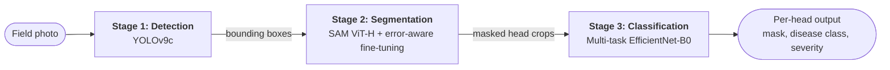

# SegWheat-DSG

**A Segmentation-Guided Framework for Wheat Head Disease Detection and Severity Grading**


SegWheat-DSG takes a raw field photograph of wheat and returns, for every wheat head in it, a **segmentation mask**, a **disease class**, and a **severity grade**. It extends [WheatSAM](#acknowledgments) (YOLOv9 detection + SAM segmentation) with a third stage: a multi-task EfficientNet-B0 that classifies each isolated head.

## At a glance

| Stage | Task | Dataset | Headline result |
|---|---|---|---|
| 1 | Wheat head detection (YOLOv9c) | GWHD 2021 | **93.9%** mAP@50 |
| 2 | Wheat head segmentation (SAM ViT-H) | GWFSS v1.0 | **87.61%** Dice, **79.56%** mIoU |
| 3 | Disease (5 classes) and severity (3 levels) | Bangladesh Wheat Disease Dataset | **99.59%** / **99.51%** accuracy on 241 held-out images |

Please read the [limitations](#limitations) before comparing these numbers with other work. In particular, Stage 3 was trained on the dataset's own images and has not been evaluated on crops produced by Stages 1 and 2.

## Pipeline



The design premise is that classifying an isolated, background-free head should be easier than classifying a whole field image, because soil, stems, and neighbouring plants no longer add noise. This repository does not yet include a controlled whole-image versus segmented-crop comparison, so the premise is untested here (see [Limitations](#limitations)).

### Stage 1: Detection

YOLOv9c (25.5M parameters, 358 layers, 103.7 GFLOPs), initialised from COCO weights with the head reconfigured for a single class. It uses the same backbone as WheatSAM, so detection results are directly comparable.

- **Augmentation:** mosaic (p=1.0), mixup (p=0.1), horizontal flip (p=0.5), vertical flip (p=0.2), HSV jitter (h=0.015, s=0.7, v=0.4), scale ±50%, shear ±2°, translation ±10%.
- **Preprocessing:** boxes converted to YOLO normalised format; five duplicate labels removed.

### Stage 2: Segmentation

SAM ViT-H turns each detected box into a mask. The image encoder (632M parameters) is **frozen**; only the prompt encoder and mask decoder (about 4.06M parameters) are fine-tuned.

- **Error-aware training** (from WheatSAM): ground-truth boxes are perturbed during training to mimic detector errors (probability 0.8, shift ±20 px, scale ±20%, minimum IoU 0.1). No perturbation is applied at inference; detector boxes go to SAM directly.
- **Loss:** `L_seg = L_Dice + L_Focal + L_IoU`.
- **Data handling:** images resized to 1024×1024, masks to 256×256 (nearest neighbour); per-head boxes extracted by connected-component analysis.

### Stage 3: Multi-task classification

EfficientNet-B0 (about 5.3M parameters, ImageNet-pretrained) with one shared backbone and two heads, each `Dropout(0.3) → Linear(f, 256) → ReLU → Dropout(0.2) → Linear(256, k)`, with k = 5 for disease and k = 3 for severity.

- **Loss:** `L = L_disease + 0.5 · L_severity`, both cross-entropy. The severity loss is masked to diseased samples only (label > 0), so the model is never penalised for severity predictions on healthy crops.
- **Input:** 224×224, ImageNet normalisation. A `WeightedRandomSampler` (weights inversely proportional to class frequency) counters class imbalance.

| Label | Disease class | Severity |
|---|---|---|
| 0 | Healthy | None |
| 1 | Black Point | Mild |
| 2 | Fusarium Foot Rot | Moderate |
| 3 | Leaf Blight | Moderate |
| 4 | Wheat Blast | Severe |

Severity is assigned from the disease class using an agronomic mapping. It is not annotated per image (see [Limitations](#limitations)).

## Results

### Stage 1: Detection (GWHD 2021 validation set)

| Metric | SegWheat-DSG | WheatSAM (reported) |
|---|---|---|
| mAP@50 | 93.9% | 87.41% |
| mAP@50-95 | 53.9% | 44.67% |
| Precision | 91.8% | n/a |
| Recall | 88.2% | n/a |

Training stopped early at epoch 45 and the best checkpoint is from epoch 25. The paper attributes the gain over WheatSAM to mosaic, mixup, and vertical-flip augmentation, which WheatSAM did not use. No ablation isolates that effect.

### Stage 2: Segmentation (GWFSS v1.0, no box perturbation)

| Model | Dice | mIoU |
|---|---|---|
| WheatSAM, zero-shot | 89.45% | 81.51% |
| WheatSAM, error-aware | 89.74% | 81.96% |
| Najafian et al. | 89.00% | n/a |
| **SegWheat-DSG** | **87.61%** | **79.56%** |

These rows are **not a like-for-like comparison**. WheatSAM was fine-tuned and evaluated on its own single-domain Roboflow dataset (439 images). SegWheat-DSG was trained and evaluated on a multi-institution split of GWFSS v1.0, and the two evaluations differ in difficulty. SegWheat-DSG trained for all 30 epochs, with final training and validation losses of 0.5809 and 0.5749.

### Stage 3: Classification (Bangladesh Wheat Disease Dataset, 241 test images)

**Disease detection (5 classes): 99.59% accuracy (240 of 241 correct)**

| Class | Precision | Recall | F1 | Support |
|---|---|---|---|---|
| Healthy | 0.97 | 1.00 | 0.99 | 38 |
| Black Point | 1.00 | 0.98 | 0.99 | 45 |
| Fusarium Foot Rot | 1.00 | 1.00 | 1.00 | 38 |
| Leaf Blight | 1.00 | 1.00 | 1.00 | 60 |
| Wheat Blast | 1.00 | 1.00 | 1.00 | 60 |

**Severity grading (3 levels, 203 diseased images): 99.51% accuracy (202 of 203 correct)**

| Severity | Precision | Recall | F1 | Support |
|---|---|---|---|---|
| Mild | 1.00 | 0.98 | 0.99 | 45 |
| Moderate | 0.99 | 1.00 | 0.99 | 98 |
| Severe | 1.00 | 1.00 | 1.00 | 60 |

Early stopping triggered at epoch 13 (best validation accuracy 98.8%, best validation disease F1 0.9875).

<p align="center"></p>

*Test-set confusion matrices. Each task has a single error: a Black Point image predicted as Healthy, and a Mild image predicted as Moderate.*

### Example pipeline output

<p align="center"></p>

*Left: input field image. Right: per-head masks, disease labels, and severity grades from the full pipeline. This is an illustration, not a validated result: GWHD images carry no disease annotations, so these predictions have no ground truth, and Stage 3 was trained on a different dataset.*

## Datasets

| Stage | Dataset | Size | Notes |
|---|---|---|---|
| 1 | GWHD 2021 (David et al., *Plant Phenomics*, 2021) | 6,514 images at 1024×1024; 275,000+ wheat-head boxes | Official train/validation split used unchanged |
| 2 | GWFSS v1.0 (GlobalWheat Consortium, *Plant Phenomics*, 2025) | 1,096 annotated images; 80/20 stratified split gives 876 train / 220 validation | The 48,675 unannotated images are unused |
| 3 | [Bangladesh Wheat Disease Dataset](https://data.mendeley.com/datasets/5gc7hwydwg/1) (Mendeley Data) | 1,603 original images at 1920×1080: Black Point 303, Fusarium Foot Rot 250, Healthy 250, Leaf Blight 400, Wheat Blast 400 | 70/15/15 stratified split gives 1,122 / 240 / 241 |

Use the **1,603 original images only**. The Mendeley record also provides an augmented, balanced release (5,000 images); mixing augmented copies of one photo across splits would inflate accuracy. The paper lists all three datasets as CC BY 4.0, but check each dataset page before reuse.

<details>
<summary><b>Training hyperparameters</b></summary>

| Parameter | Stage 1 | Stage 2 | Stage 3 |
|---|---|---|---|
| Model | YOLOv9c | SAM ViT-H | EfficientNet-B0 |
| Optimizer | AdamW | AdamW | AdamW |
| Learning rate | 5e-4 | 1e-7 | 1e-4 |
| Weight decay | 5e-4 | 1e-5 | 1e-4 |
| Batch size | 4 | 1 | 32 |
| Max epochs | 100 | 30 | 30 |
| Early stopping | patience 20 | none | patience 7 |
| LR schedule | Cosine annealing | Fixed | ReduceLROnPlateau |
| Mixed precision | Yes | Yes (AMP) | Yes |

</details>

## Reproducing

**Versions used in the paper:** Python 3.13, PyTorch 2.11.0 (CUDA 12.8), Ultralytics 8.4.48 (YOLOv9), timm 0.9, plus scikit-learn, OpenCV, and Meta AI's [Segment Anything](https://github.com/facebookresearch/segment-anything) library.

```bash
pip install torch torchvision ultralytics timm scikit-learn opencv-python
pip install git+https://github.com/facebookresearch/segment-anything.git
```

1. Download the SAM ViT-H checkpoint from the Segment Anything repository, and the three datasets listed above.
2. Open `SegWheat-DSG.ipynb` in Jupyter with a CUDA GPU and set the dataset and checkpoint paths the notebook uses.

<!-- TODO: after checking the notebook, list the exact paths to edit and the order of the stages. -->

```
.
├── SegWheat-DSG.ipynb    # implementation notebook
├── docs/                 # figures used in this README
└── README.md
```

## Limitations

- **Stage 3 has not seen pipeline output.** It was trained on images from the Bangladesh dataset, not on crops produced by the live Stage 1 and 2 pipeline, so detection and segmentation errors will propagate in real use. True end-to-end performance is unmeasured.
- **The core premise is untested here.** The claim that segmentation makes classification easier has no controlled whole-image versus segmented-crop experiment behind it.
- **Severity is derived from disease class.** Labels follow a fixed mapping (Black Point is Mild, Fusarium Foot Rot and Leaf Blight are Moderate, Wheat Blast is Severe), so the severity head largely re-encodes the disease prediction. Its accuracy does not measure how much of a head is infected; a field that is 15% infected and one that is 85% infected can both be labelled Severe.
- **The Stage 3 test set is small.** It has 241 images, with one error per task, so a difference of one or two points between systems is within noise. The split is stratified by class only, so near-duplicate images across train and test cannot be ruled out.
- **Stage 1 model selection used the reporting set.** The best checkpoint was chosen on the same GWHD validation set the metrics are reported on; no separate test set was held out.
- **Stage 2 is not comparable to WheatSAM.** See the note under the Stage 2 table.
- **Geographic scope.** The classifier was trained only on Bangladeshi field imagery. Other regions, cultivars, and pathogen strains are untested.

## Future work

- Run a controlled whole-image versus segmented-crop ablation for Stage 3.
- Retrain and evaluate Stage 3 on crops produced by the live pipeline.
- Replace the class-derived severity labels with per-image annotations or a continuous severity regression head.
- Use the 48,675 unannotated GWFSS images for semi-supervised SAM fine-tuning.
- Validate across other regions, cultivars, and imaging conditions.

## Citation

If you use this work, please cite:

```bibtex
@inproceedings{hossain2026segwheatdsg,
  title     = {{SegWheat-DSG}: A Segmentation-Guided Framework for Wheat Head Disease Detection and Severity Grading},
  author    = {Hossain, Md Sazid and Mahin, Siddatul Muntaha Chowdhury and Hasnat, Abu Sadik Md. Waliul},
  booktitle = {IEEE 3rd International Conference on Computing, Applications and Systems (COMPAS)},
  address   = {Dhaka, Bangladesh},
  year      = {2026},
  note      = {Accepted}
}
```

## Acknowledgments

Built on WheatSAM (Al Nahian et al., 2024), Segment Anything (Kirillov et al., 2023), YOLOv9 (Wang et al., 2024), and EfficientNet (Tan and Le, 2019). Thanks to Rashik Rahman, Lecturer, Department of CSE, University of Asia Pacific, for guidance and support throughout the project.

Maintained by Md Sazid Hossain ([@MD-SAZID-HOSSAIN](https://github.com/MD-SAZID-HOSSAIN)), Department of CSE, University of Asia Pacific, Dhaka.
